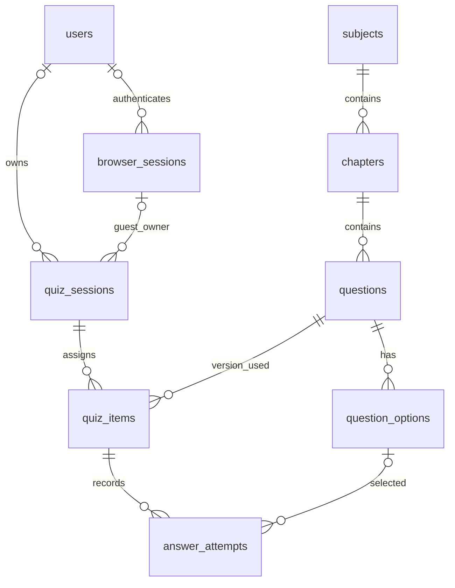

# SQLD 학습 사이트 DB 설계안

작성일: 2026-10-28 / 상태: 제안 문서. DB·마이그레이션·애플리케이션을 생성하거나 실행한 문서가 아니다.

## 1. 목적과 확정된 요구사항

- Next.js App Router + TypeScript + Tailwind CSS + TanStack Query, FastAPI + SQLModel + psycopg, Neon PostgreSQL을 사용한다. DB 변경 이력은 Alembic으로 관리한다.
- 공개 문제풀이 사이트다. 문제 조회, 문항별 채점·해설, 모의시험과 해당 시험 결과는 로그인 없이 사용할 수 있다.
- 카카오 OAuth 첫 로그인 때 내부 사용자를 만든다. 별도 회원가입 입력 화면은 없다. 개인 오답·통계·시험 이력·기기 간 이어 풀기는 로그인 사용자에게 제공한다.
- 로그인 전에 진행하던 현재 풀이 기록은 로그인 후 계정에 연결한다. 다른 사람의 기록과 합치거나 같은 기록을 복사해서 중복 생성하지 않는다.
- 정답 문항 수와 오답 목록은 문항별 최신 유효 채점 결과로 계산한다. 같은 문항을 반복해서 맞혀도 한 문항이며, 이후 틀리면 정답 문항 수에서 빼고 오답 목록에 넣는다.
- 학습 모드는 선택한 과목·단원의 문제를 책 순서대로 풀고 문항마다 채점한다. 명시적으로 다시 풀기를 선택하면 새 답안 시도를 만든다.
- 모의시험은 1과목 10개 + 2과목 40개, 총 50개를 회차 내 중복 없이 추출한다. 보기 순서는 원문을 유지한다. 90분 뒤 또는 수동 제출 시 일괄 채점한다.
- 모의시험은 정답당 2점이다. 총점 60점 이상이고 1과목 8점/20점 이상, 2과목 32점/80점 이상이면 합격이다. 미응답은 오답이다.
- 시험 시작 시 저장한 종료 시각은 로그인, 새로고침, 창 닫기, 재접속으로 연장되지 않는다.
- 문제의 본문·SQL·보기·정답·해설은 제공 PDF에서 변환·검수한다. 표·ERD는 이미지로 보존한다. 현재 수록 번호 기준 목표는 1과목 50개, 2과목 126개다. 실제 전수 목록 대조는 아직 수행하지 않았다.
- 모바일·PC를 모두 지원한다. UI 디자인은 별도 AI의 결과를 보고 사용자가 판단한다. 이 문서는 화면의 데이터 계약과 상태 전이의 기준이다.

## 2. 접근 방식과 제안 기본값

문제은행, 출제 목록, 답안 시도를 분리하는 관계형 구조를 권장한다. 단원·선택지·응시 기록의 연결을 외래키로 검증하고, 같은 문제를 다시 풀어도 과거 채점 결과를 보존한다.

사용자별 정답 수나 오답 목록을 별도 원본 테이블로 중복 저장하지 않는다. 유효한 채점 이력에서 조회해 계산한다. 현재 규모에서는 별도의 통계 캐시, 이벤트 시스템, 범용 콘텐츠 관리 시스템을 도입하지 않는다.

아래는 사용자 확정 사항과 구분되는 설계 제안이다.

- 첫 버전 입력은 원문 검수로 확인한 단일 선택 객관식을 기준으로 한다. 한 문항에서 고르는 답은 하나다. 실제 자료에 복수 선택 등 다른 유형이 발견되면 임의로 단일 선택으로 바꾸거나 누락시키지 않고, 공개 데이터 확정 전에 이 설계를 보완한다.
- 문항별 선택지의 수와 번호는 원본에서 검증한다. DB가 임의로 선택지 내용을 생성하지 않는다.
- 게스트 현재 풀이 기록은 같은 브라우저에서 임시 유지하고 마지막 활동 후 7일 보관한다. 로그인하면 현재 풀이를 영구 기록으로 전환한다. 7일은 제안 보관 기간이며 공개 전 확정한다.
- 로그인 세션 만료는 발급 후 30일을 제안한다. 로그아웃 시 즉시 무효화한다. 카카오 토큰의 만료와 서비스 로그인 세션의 만료는 별개다.
- 하나의 브라우저에는 현재 학습 세션과 현재 모의시험을 각각 하나씩 표시한다. 계정 전체의 활성 세션을 하나로 강제하지 않는다. 로그인 기록 연결이 다른 기기에서 진행 중인 풀이를 덮어쓰지 않는다.

## 3. 테이블 관계

총 9개 테이블이다. `browser_sessions`는 문제풀이 기록이 아니라 게스트 소유권과 로그인 유지에 사용하는 접속 세션이다.



모든 시간 필드는 `timestamptz`를 사용하고, API는 UTC 시각과 오프셋을 명시한 ISO 8601 문자열을 반환한다. 화면에서 사용자 시간대로 표시한다. 사용자·접속·풀이·문항 배정·답안 시도 ID는 UUID를 사용한다. 과목·단원은 고정 정수 ID, 문항과 선택지는 UUID로 통일한다.

### 3.1 users — 서비스 사용자

| 필드 | 형식 | 의미 |
|---|---|---|
| id | uuid, PK | 서비스 내부 사용자 ID |
| kakao_id | text, UNIQUE, NOT NULL | 서버가 확인한 카카오 회원번호. 문자열로 보관 |
| display_name | text, nullable | 동의받아 사용할 표시명. 없어도 로그인 가능 |
| created_at | timestamptz | 최초 생성 시각 |
| last_login_at | timestamptz | 마지막 로그인 시각 |

이메일·전화번호·비밀번호는 첫 버전에서 수집·저장하지 않는다. 카카오 회원번호는 프론트 입력을 신뢰하지 않고 OAuth 서버 연동으로 확인한다. 카카오 access/refresh token을 이 테이블이나 브라우저 저장소에 그대로 저장하지 않는다.

### 3.2 browser_sessions — 접속 세션

| 필드 | 형식 | 의미 |
|---|---|---|
| id | uuid, PK | 접속 세션 내부 ID |
| token_hash | text, UNIQUE | 쿠키에 전달한 고엔트로피 임의 토큰의 해시 |
| user_id | uuid, nullable FK users | NULL이면 게스트, 값이 있으면 로그인한 사용자 |
| created_at | timestamptz | 생성 시각 |
| last_seen_at | timestamptz | 활동 시각 |
| expires_at | timestamptz | 세션 유효기간 |
| revoked_at | timestamptz, nullable | 로그아웃·폐기 시각 |
| oauth_pending | jsonb, nullable | 서버가 만든 일회성 OAuth state 해시·안전한 복귀 경로·현재 풀이 ID·만료 시각·pending/processing 상태 |

클라이언트에는 원본 토큰을 HttpOnly 쿠키로 전달하고 DB에는 해시만 보관한다. 운영 쿠키는 Secure와 SameSite=Lax를 기본으로 한다. 카카오 로그인 성공 시 토큰을 회전한다. OAuth의 일회성 state 검증은 검증된 OAuth 라이브러리로 수행하고, 서비스 로그인 토큰과 구분한다.

로그인 성공은 기존 접속 행의 user_id·token_hash를 갱신하고 행 ID는 유지한다. 캐시 구분용 viewer_key는 guest:<접속 ID>에서 user:<사용자 ID>로 바뀐다. 로그아웃은 기존 행을 폐기하고 새 guest 행을 만든다.

이 쿠키 설계는 브라우저가 동일 출처의 API 경로를 사용한다는 전제다. 프론트와 FastAPI를 별도 배포할 때의 API 전달 경로와 OAuth 콜백은 배포·인증 명세에서 함께 확정한다. 상태 변경 요청에는 Origin 검증 등 CSRF 방어를 적용한다.

oauth_pending은 접속당 하나를 보관하며 콜백에서 원래 접속·해시·기한을 확인하고 pending→processing 조건부 갱신으로 한 번만 소비한다. 외부 통신 후 최종 로그인 트랜잭션에서도 동일 접속·state 문맥을 재검증하여 로그아웃·다른 탭의 새 로그인을 덮어쓰지 않는다. 성공 후 비우며 실패 정리는 같은 해시에만 적용한다. 원본 state와 카카오 토큰은 저장하지 않는다. 상세 규칙은 [API 명세](2026-10-28-api-design.md)의 로그인 절차를 따른다.

### 3.3 subjects — 과목

| 필드 | 형식 | 의미 |
|---|---|---|
| id | smallint, PK | 과목 ID |
| name | text | 과목명 |
| display_order | smallint, UNIQUE | 표시 순서 |

초기 데이터는 데이터 모델링의 이해 / SQL 기본 및 활용 두 과목이다. 시험의 10:40 출제 비율과 2점 배점은 별도 시험 유형 관리 기능 없이 백엔드의 고정 시험 규칙으로 관리한다.

### 3.4 chapters — 단원

| 필드 | 형식 | 의미 |
|---|---|---|
| id | smallint, PK | 단원 ID |
| subject_id | smallint, FK subjects | 소속 과목 |
| name | text | 원문 단원명 |
| display_order | smallint | 과목 내 순서 |

`UNIQUE(subject_id, display_order)`로 단원 순서 중복을 막는다. 문항의 과목은 단원에서 구하므로 questions에 subject_id를 중복 저장하지 않는다.

### 3.5 questions — 문항의 특정 버전

| 필드 | 형식 | 의미 |
|---|---|---|
| id | uuid, PK | 이 문항 버전의 ID |
| question_key | text | 논리 문항의 고정 키. 예: S1-Q001 |
| version | integer | 같은 논리 문항의 버전. 1부터 증가 |
| chapter_id | smallint, FK chapters | 소속 단원 |
| source_number | integer | 책에 표시된 문항 번호 |
| content_blocks | jsonb | 본문·SQL·이미지 블록의 순서 있는 배열 |
| explanation_blocks | jsonb | 원문 해설 블록. 일반 문제 조회 API에서는 제외 |
| question_page_start / question_page_end | integer | 문제 PDF의 실제 1-based 페이지 범위 |
| answer_page_start / answer_page_end | integer | 해설 PDF의 실제 1-based 페이지 범위 |
| status | text | draft / published / retired |
| created_at | timestamptz | 이 버전의 생성 시각 |

`UNIQUE(question_key, version)`, `version > 0`, 양수 페이지 범위 및 시작≤끝을 검증한다. published에 한정한 부분 고유 인덱스로 같은 question_key에 현재 공개 버전을 하나만 둔다.

공개한 버전의 본문·해설·선택지는 수정하지 않는다. 수정 시 새 questions 행과 선택지를 만들고, 한 트랜잭션에서 기존 버전을 retired, 새 버전을 published로 바꾼다. 과거 시험은 계속 기존 ID를 참조하고 새 출제는 published만 사용한다. question_key는 같은 문항의 과거·현재 버전을 묶는 통계 기준이다.

이미지는 파일 경로/객체 키만 기록한다. 문항 버전이 포함된 불변 경로를 사용하며 같은 경로의 파일을 교체하지 않는다. 문항·보기·해설의 과거 버전에서 참조하는 이미지는 함께 보존한다. 이미지·PDF 바이너리와 임의 HTML을 DB 본문에 넣지 않는다. 블록은 최소한 다음 세 유형을 사용하고 FastAPI와 프론트가 같은 규격을 따른다.

```json
[
  { "type": "text", "text": "문제 본문" },
  { "type": "sql", "text": "SELECT ...\nFROM ..." },
  { "type": "image", "src": "/question-assets/S1-Q001/v1/diagram.webp", "alt": "문항에 제시된 관계도" }
]
```

### 3.6 question_options — 선택지

| 필드 | 형식 | 의미 |
|---|---|---|
| id | uuid, PK | 선택지 ID |
| question_id | uuid, FK questions | 소속 문항 버전 |
| option_number | smallint | 원본 보기 번호 및 순서 |
| content_blocks | jsonb | 보기의 텍스트·SQL·이미지 |
| is_correct | boolean | 정답 여부. 일반 조회 API에서 제외 |

`UNIQUE(question_id, option_number)`와 `UNIQUE(id, question_id)`를 둔다. 단일정답 검수 완료 문항은 is_correct=true가 정확히 하나여야 한다. 부분 고유 인덱스로 문항별 정답을 최대 하나로 제한하고, 정확히 하나 존재하는지와 원문 보기 수·번호는 게시/가져오기 트랜잭션에서 검증한다.

### 3.7 quiz_sessions — 한 번의 학습 또는 모의시험

| 필드 | 형식 | 의미 |
|---|---|---|
| id | uuid, PK | 풀이 세션 ID |
| user_id | uuid, nullable FK users | 영구 기록 소유자. 게스트 동안 NULL |
| browser_session_id | uuid, nullable FK browser_sessions | 현재 게스트 소유권 확인에 사용할 접속 세션 |
| mode | text | study / mock |
| study_filter | jsonb, nullable | 학습 시작 시 과목·단원·오답 필터. 검증된 입력만 저장 |
| status | text | active / completed / abandoned |
| current_position | integer | 현재 보고 있는 출제 순번 |
| started_at | timestamptz | 시작 시각 |
| deadline_at | timestamptz, nullable | 모의시험의 고정 종료 시각 |
| finished_at | timestamptz, nullable | 실제 의미의 종료 시각. 시간 만료는 deadline_at |
| finish_reason | text, nullable | manual / timeout / abandoned |
| last_activity_at | timestamptz | 게스트 보관 기간과 이어 풀기 기준 |
| created_at / updated_at | timestamptz | 생성·변경 시각 |

소유자는 user_id 또는 browser_session_id 중 적어도 하나가 있어야 한다. 로그인 후에는 기록의 user_id가 개인 기록 조회의 기준이다. 과거 browser_session_id로 로그인 사용자의 기록 권한을 우회하지 않는다.

mode와 상태 값, current_position≥1, mock은 deadline_at 필수·study는 NULL을 CHECK로 검증한다. active는 finished_at·finish_reason이 모두 NULL, completed는 finished_at과 manual/timeout 사유가 필수, abandoned는 mock에만 허용하며 finished_at과 abandoned 사유가 필수다. timeout은 mock에만 허용한다. current_position의 실제 출제 개수 범위와 과목별 배정은 API에서 검증한다. 출제 목록이 비어 있으면 세션을 생성하지 않는다.

모의시험 총점·과목별 정답 수·정답률은 고정된 quiz_items와 각 문항의 확정 답안 하나에서 계산한다. 학습 세션 요약은 quiz_item별 최신 채점 완료 시도 하나로 계산한다. 재시도 중인 미채점 답안은 기존 채점 이력을 대체하지 않는다. 다른 곳의 카운터를 증가시키는 방식은 사용하지 않는다. 채점 완료 답안이 바뀌지 않으므로 과거 시험 점수도 유지된다.

### 3.8 quiz_items — 이 세션에 배정된 문항

| 필드 | 형식 | 의미 |
|---|---|---|
| id | uuid, PK | 배정 문항 ID |
| quiz_session_id | uuid, FK quiz_sessions | 소속 풀이 세션 |
| question_id | uuid, FK questions | 당시 사용한 문항 버전 |
| position | integer | 세션에서의 출제 순번 |

`UNIQUE(quiz_session_id, position)`, `UNIQUE(quiz_session_id, question_id)`, `UNIQUE(id, question_id)`를 둔다. 하나의 세션에 같은 question_key의 다른 버전을 중복 배정하지 않는 것도 생성 시 검증한다.

시험 생성 시 50개 문항과 순서를 한 번 저장한다. 재조회·로그인·새로고침 때 다시 추첨하지 않는다. 학습의 책 순서 목록과 오답 복습 대상도 시작 시 이 테이블에 고정한다. 학습 중 정오답이 변해도 현재 목록이 갑자기 줄거나 순서가 바뀌지 않는다.

### 3.9 answer_attempts — 문항별 답안 시도

| 필드 | 형식 | 의미 |
|---|---|---|
| id | uuid, PK | 한 번의 답안 시도 ID |
| quiz_item_id | uuid | 배정 문항 |
| question_id | uuid | 배정된 문항 버전. 복합 외래키 검증을 위한 값 |
| attempt_number | integer | 같은 배정 문항의 시도 순번. 1부터 증가 |
| selected_option_id | uuid, nullable | 선택한 보기. 미응답이면 NULL |
| revision | integer | 답안 변경 충돌을 확인할 버전 |
| is_correct | boolean, nullable | 채점 전 NULL, 채점 후 서버 판정 |
| graded_at | timestamptz, nullable | 결과가 효력을 갖는 시각 |
| created_at / updated_at | timestamptz | 실제 생성·변경 시각 |

필수 제약은 다음과 같다.

- `(quiz_item_id, question_id)` → quiz_items의 `(id, question_id)` 복합 외래키.
- `(selected_option_id, question_id)` → question_options의 `(id, question_id)` 복합 외래키. 다른 문제의 보기를 제출할 수 없다.
- `UNIQUE(quiz_item_id, attempt_number)`, attempt_number>0, revision>0.
- graded_at이 NULL이면 is_correct도 NULL, graded_at이 있으면 is_correct는 필수.
- graded_at이 NULL인 행에 대한 quiz_item_id 부분 고유 인덱스로 현재 작성 중인 시도를 최대 하나만 허용한다.

학습은 보기 선택 시 작성 중 답안을 변경하고, 정답 확인 시 그 답안을 채점 완료한다. 채점 완료 답안은 수정하지 않는다. 다시 풀기는 다음 attempt_number로 새 행을 만든다. 같은 채점 요청을 다시 보내면 기존 결과를 반환한다.

모의시험은 각 quiz_item에 attempt_number=1만 사용한다. 제출 전에는 선택만 변경하며 is_correct·graded_at은 NULL이다. 전체 제출 시 모든 출제 문항에 대해 답안을 확정하고, 미응답도 is_correct=false로 채점한다. 제출 후 답안 변경과 개별 재채점은 허용하지 않는다. 결과 복습에서 다시 풀려면 새 학습 세션을 만든다.

## 4. 핵심 처리 흐름

### 4.0 모드별 상태 전이

| 모드·현재 상태 | 동작 | 결과 |
|---|---|---|
| study / active | 보기 선택·문항 채점·문항 다시 풀기 | active 유지 |
| study / active | 사용자가 학습 종료 선택 | completed / manual. 미채점 답안은 점수에 포함하지 않음 |
| study / completed | 다시 학습·오답 복습 선택 | 기존 세션은 보존하고 새 study 세션 생성 |
| mock / active | 마감 전 수동 제출 | completed / manual |
| mock / active | 종료 시각 도달 | completed / timeout |
| mock / active | 마감 전 명시적인 시험 포기 확인 | abandoned / abandoned. 점수·정답·해설 공개 없이 종료 |
| mock / completed 또는 abandoned | 답안 변경·재채점·재개 | 거부. 기존 결과는 유지하고 새 시험만 생성 가능 |

학습은 마지막 문항을 채점했다고 자동으로 다른 화면으로 이동하거나 종료하지 않는다. 해설을 읽고 다시 풀 수 있게 active를 유지하고, 사용자가 학습 종료를 선택하면 요약으로 이동한다. 종료 후에는 원래 세션 답안을 바꾸지 않는다. 같은 범위로 다시 학습하면 당시 목록의 논리 문항 키를 현재 공개 버전으로 새로 배정하며, 오답 복습은 현재 오답 목록으로 새 세션을 만든다.

창 닫기·화면 이동·로그아웃·다른 기기 로그인만으로 mock을 포기 처리하지 않는다. 동일 브라우저에서 새 모의시험을 시작할 때 기존 active 시험이 있으면 계속 풀기 또는 명시적인 포기를 선택하게 한다. 포기 요청 시 이미 마감됐으면 abandoned로 바꾸지 않고 timeout 채점을 완료한다. 기한이 지나기 전 사용자가 명시적으로 포기한 시험만 자동 채점 대상에서 제외한다.

### 4.1 게스트로 풀다가 로그인

1. 게스트 접속 토큰으로 현재 quiz_session 소유권을 확인한다.
2. 카카오 로그인으로 서버가 확인한 kakao_id를 이용해 users를 생성 또는 조회한다. 동일 카카오 계정은 UNIQUE 제약으로 한 사용자에 대응한다.
3. 로그인 시작 시 지정된 현재 풀이 세션만 가져온다. 이 브라우저에서 과거에 풀었던 게스트 기록 전체를 자동 편입하지 않는다.
4. DB 트랜잭션에서 해당 quiz_sessions 행을 잠그고, 아직 user_id가 NULL이고 현재 브라우저가 소유한 경우에만 user_id를 설정한다.
5. quiz_items와 answer_attempts는 복사하지 않는다. 이미 같은 사용자에게 연결되었으면 기존 결과를 반환하고, 다른 사용자에게 연결된 기록은 가져올 수 없다.
6. 로그인 세션 토큰을 회전하고 원래 화면으로 복귀한다. 문제 순서·답안·deadline_at은 유지한다. 로그인 취소·실패는 게스트 답안을 삭제하지 않는다.

### 4.2 모의시험 저장·제출·시간 만료

- 모든 답안 변경과 제출은 동일한 부모 quiz_session 상태를 확인하고 일관된 순서로 잠근다. active인 동안만 답안을 바꿀 수 있다.
- 답안 변경은 revision을 확인한다. 오래된 요청은 새 답안을 덮어쓰지 않고 충돌 응답과 현재 상태를 반환한다.
- 마감 판정은 서버 시각을 사용하며, 잠금 대기 후에도 마감 여부를 다시 확인한다. 브라우저 시각이나 사용자가 전달한 점수를 신뢰하지 않는다.
- 제출은 한 트랜잭션에서 답안을 채점하고 quiz_session을 종료한다. 재제출은 기존 결과를 반환한다. 일부만 채점된 시험은 외부에 완료로 노출하지 않는다.
- 만료된 시험을 늦게 열었을 때도 자동 채점한다. 타이머와 정답 판정을 서버 프로세스 메모리나 백그라운드 타이머에 의존시키지 않는다.
- 시간 만료 시 finished_at과 답안의 graded_at은 deadline_at을 사용하고, updated_at은 실제 처리 시각을 남긴다. 며칠 뒤 자동 정리된 오래된 시험이 최근 학습 결과를 덮지 않게 한다.
- 시험 목록·통계를 조회할 때에는 해당 사용자의 기한 지난 active 시험을 먼저 확정하거나, 결과 계산에서 동일한 만료 규칙을 적용한다.

### 4.3 오답·정답 통계

- user_id가 로그인 사용자와 일치하고 채점 완료된 유효 답안만 사용한다.
- 학습은 문항별 채점 완료 즉시 반영하고, 모의시험은 전체 종료 이후 반영한다. 중단한 미제출 시험의 임시 답안은 통계에 포함하지 않는다.
- questions.question_key별로 graded_at DESC, answer_attempts.id DESC의 결정적인 순서를 사용한다. 문항 버전이나 재시도 횟수 때문에 문항 수가 늘어나지 않는다.
- 사용자 확정 기준: 가장 최근의 유효 결과가 오답이면 오답 목록, 정답이면 정답 문항으로 계산한다. 작성 중 답안이나 로그인 동작만으로 통계가 바뀌지 않는다.
- '정답 문항 수'와 '채점 문항 수'를 구분해 표시한다. 모의시험 미응답도 오답으로 판정되므로 채점 문항 수에 포함한다. 정답률은 정답 문항 수 / 채점 문항 수이며, 분모가 0이면 0%로 표시한다.
- 오답 복습은 현재 published 문항 버전을 사용한다. 과거 시험 다시보기는 당시 question_id의 본문·보기·해설과 당시 판정을 사용한다.
- 이번 회차의 점수와 사용자의 문항별 최신 통계는 다른 지표다. 과거 시험 80점은 이후 복습으로 달라지지 않는다.

### 4.4 소유권·로그아웃·데이터 삭제

- 사용자 개인 기록 API는 요청의 user_id가 아니라 유효한 로그인 세션의 user_id로 소유권을 판정한다.
- 게스트는 유효한 접속 토큰으로 소유한 현재 풀이만 조회·수정할 수 있다. UUID나 quiz_session ID를 아는 것만으로 접근할 수 없다.
- 로그인된 기록은 user_id로 권한을 확인한다. 이전 게스트 쿠키는 로그인 전환 시 회전되어 더 이상 사용할 수 없다.
- 로그아웃하면 접속 세션을 무효화하고 새 게스트 세션을 만든다. 프론트의 개인 기록 캐시와 개인 풀이 화면 상태도 비운다. 서버에 저장된 사용자 학습 기록은 보존한다.
- 익명 기록 정리 시 user_id IS NULL인 임시 기록만 삭제한다. 로그인으로 편입된 기록은 대상에서 제외한다.
- 접속 세션을 물리적으로 정리할 때에는 그 세션이 소유한 만료 익명 풀이를 먼저 삭제한다. 이후 browser_session 삭제는 로그인 기록의 browser_session_id만 NULL로 만들고, user_id로 소유된 기록은 보존한다. 소유자가 전혀 없는 익명 풀이가 남는 삭제 순서는 허용하지 않는다.
- 참조된 문항 버전의 삭제는 제한한다. 풀이 세션 삭제 시 그 세션의 quiz_items와 answer_attempts만 함께 삭제한다.
- 사용자 탈퇴 시 해당 사용자의 개인 기록·접속 세션 삭제 규칙을 별도로 구현한다. 다른 사용자의 기록과 공용 문제은행에는 영향을 주지 않는다.

## 5. 화면 및 API 데이터 계약

이 목록은 화면 AI가 사용할 데이터 범위다. 실제 URL·응답 스키마 전체는 [API 명세](2026-10-28-api-design.md)와 [OpenAPI 파일](2026-10-28-openapi.json)을 따른다.

| 화면/동작 | 필요한 데이터 | 공개 범위 |
|---|---|---|
| 시작 화면 | 과목·단원·공개 문항 수, 로그인 여부 | 공개 |
| 문제풀이 | quiz_session ID·상태·현재 순번·deadline_at, quiz_item, 본문 블록·보기, 본인 선택 답안 | 본인 게스트/사용자 풀이 |
| 학습 채점 | 선택 결과·정답 보기·해설 | 해당 답안 채점 완료 후 |
| 모의시험 진행 | 출제 순번과 응답 여부, 본인 선택 답안 | 제출 전 정답·해설·is_correct 제외 |
| 이번 시험 결과 | 총점·과목별 점수·합격/과락·문항별 결과와 해설 | 종료된 본인 풀이. 게스트도 가능 |
| 내 기록 | 정답 문항 수·채점 문항 수·정답률·오답 목록·시험 이력 | 로그인 사용자 본인만 |
| 기록 저장 로그인 | 현재 quiz_session 연결 결과와 원래 화면 복귀 정보 | OAuth 검증 후 |

DB 모델 전체를 그대로 JSON 직렬화하지 않는다. FastAPI의 공개 응답 모델에서 정답 필드와 해설을 명시적으로 제외한다. TanStack Query 캐시에도 제출 전 정답이 들어가지 않게 한다. 사용자별 캐시 키를 사용하고 로그아웃·사용자 전환 시 개인 캐시를 제거한다.

## 6. 인덱스·검증·운영

초기 인덱스는 각 PK/UNIQUE 인덱스와 아래 접근 경로로 제한한다.

- questions: 현재 게시 문항 조회용 `(chapter_id, source_number)` 및 question_key의 현재 게시 버전 부분 고유 인덱스.
- quiz_sessions: `(user_id, started_at DESC)`, 게스트 현재 풀이용 browser_session_id, 미종료 모의시험의 deadline_at, 익명 정리용 last_activity_at.
- quiz_items: `(quiz_session_id, position)`, question_id.
- answer_attempts: `(quiz_item_id, attempt_number DESC)`, question_id 및 graded_at, 작성 중 답안 부분 고유 인덱스.

가져오기/게시 시 고정 문항 키·과목별 개수·선택지 번호·정답 수·이미지 파일 존재·원문 페이지 범위를 검사한다. 문제·보기·정답·해설을 원본과 대조하며, 검증되지 않은 문항을 published로 만들지 않는다. 이미 공개된 문항 수정은 버전 추가 방식만 사용한다.

개발과 운영은 Neon의 별도 브랜치·서로 다른 연결 문자열로 분리한다. 테스트나 초기 데이터 재입력이 운영의 사용자 기록을 지우지 않게 한다. DB 연결 정보는 FastAPI 환경변수에만 둔다. 스키마 변경은 배포 요청마다 실행하지 않고 Alembic 마이그레이션 단계로 적용한다. 운영 변경 전 내보내기 백업을 확보하고, 정기 백업과 익명 기록 보관 기간은 공개 전 운영 계획에서 확정한다.

## 7. 완료 검증 시나리오

1. 다른 문항의 선택지를 제출하면 DB 외래키 또는 API 검증에서 거부한다.
2. 동일 카카오 계정으로 동시 로그인해도 users가 중복 생성되지 않는다.
3. 게스트 현재 풀이를 로그인에 여러 번 연결해도 답안 수·문항 수·점수가 중복 증가하지 않는다. 다른 브라우저/사용자의 풀이 연결은 거부한다.
4. 학습에서 한 문항만 채점되고 다른 문항의 선택 상태는 유지된다. 재채점 요청은 같은 결과를 반환하며, 다시 풀기는 새 시도를 만든다.
5. 모의시험은 50개/10:40/논리 문항 중복 없음/순서 고정을 만족한다. 제출 전 정답·해설이 API와 프론트 캐시에 없다.
6. 수동 제출, 자동 시간 만료, 저장 요청이 겹쳐도 시험은 한 번만 종료되며 종료 후 답안은 바뀌지 않는다.
7. 마감 후 늦게 처리한 과거 시험이 최근 학습의 정오답 상태를 역전시키지 않는다.
8. 문항을 새 버전으로 수정해도 과거 시험의 본문·선택지·이미지·점수는 유지되고, 새 출제에는 새 버전만 사용된다. 과거 이미지 파일 덮어쓰기·삭제도 금지된다.
9. 답안 저장 충돌과 실패는 사용자에게 표시되고, 오래된 자동 저장이 새 선택을 덮지 않는다.
10. 로그아웃 후 같은 브라우저를 다른 사용자가 이용해도 이전 사용자의 개인 기록이 보이지 않는다.
11. 익명 기록 정리는 로그인 편입 기록을 삭제하지 않는다. 운영과 개발의 연결 문자열이 분리된다.
12. 학습 종료 전에는 마지막 문항도 다시 풀 수 있다. 종료 후에는 새 학습 세션을 만들며 기존 요약은 바뀌지 않는다. 모의시험 화면을 닫거나 교체하는 것만으로 시간 만료 채점을 피할 수 없다. 마감 후 포기 요청도 시간 만료 결과를 반환한다.

## 8. 아직 확정/검증하지 않은 사항

- 게스트 7일 보관, 로그인 30일 만료는 설계 제안이다. 실제 서비스 정책으로 아직 승인된 값은 아니다.
- 단일 선택 이외의 원문 유형 존재 여부, 전체 문항 목록과 정답 대응은 전수 검수 전이다.
- 실제 PostgreSQL DDL 실행·제약조건 테스트, Neon 프로젝트 생성, OAuth 연결, 마이그레이션·배포는 수행하지 않았다.
- 제공 교재 문항을 누구나 볼 수 있게 공개할 수 있는지는 별도로 확인할 사항이다. 이 문서는 공개 사용 권한이 확보되었다고 가정하지 않는다.

## 참고한 공식 문서

- [PostgreSQL 제약조건](https://www.postgresql.org/docs/current/ddl-constraints.html)
- [PostgreSQL 부분 인덱스](https://www.postgresql.org/docs/current/indexes-partial.html)
- [PostgreSQL 행 잠금](https://www.postgresql.org/docs/current/explicit-locking.html)
- [PostgreSQL 날짜·시간](https://www.postgresql.org/docs/current/datatype-datetime.html)
- [Neon 개발 브랜치](https://neon.com/docs/introduction/branching)
